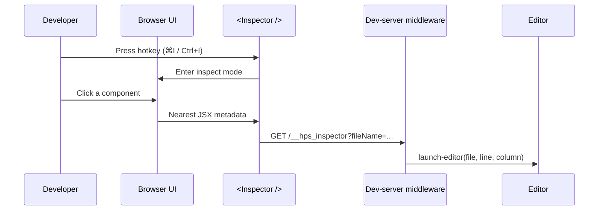

# Introduction

**Hyperse Code Inspector** is a small toolchain that connects what you see in
the browser with your local editor. After you wire a React `<Inspector />`,
press the hotkey, click a component, and your IDE opens the source file at the
correct line and column.

## Packages at a glance

| Package                           | Role                                                      |
| --------------------------------- | --------------------------------------------------------- |
| `@hyperse/inspector`              | React component, hotkeys, client → server launch request  |
| `@hyperse/inspector-middleware`   | Express-compatible middleware using `launch-editor`       |
| `@hyperse/next-inspector`         | Next.js plugin (SWC + API route + optional client inject) |
| `@hyperse/inspector-babel-plugin` | Babel transform for JSX metadata (dev)                    |
| `@hyperse/inspector-swc-plugin`   | SWC wasm plugin for the same metadata                     |
| `@hyperse/inspector-common`       | Shared constants and types (endpoints, editors)           |
| `@hyperse/inspector-component`    | Overlay / context UI primitives                           |

## Why use it?

- **Onboarding:** New teammates find unfamiliar UI code without spelunking
  `grep`.
- **OSS contribution:** Jump from a rendered page to implementation quickly.
- **Day-to-day:** Fewer context switches between DOM and repository layout.

## Requirements

- React app with JSX/TSX in development.
- A dev server where you can register middleware (or Next.js with the official
  plugin).
- An editor supported by [`launch-editor`](https://github.com/yyx990803/launch-editor)
  (VS Code, Cursor, JetBrains, Neovim, etc.).

## Next steps

<OverviewPage />
